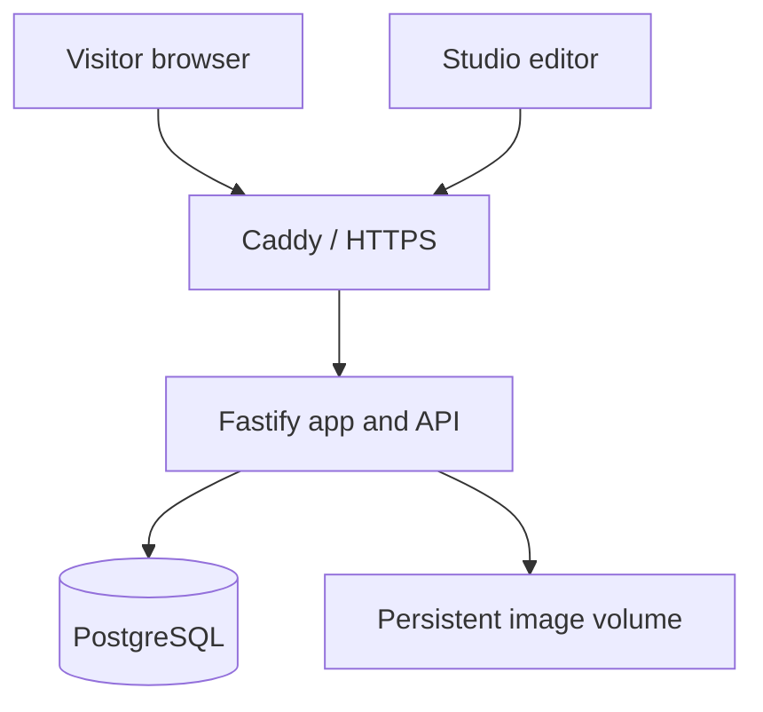

# Architecture

## Runtime

One Node.js/Fastify application serves the public HTML/JS/CSS, the studio, images and the JSON API. Caddy terminates TLS and forwards requests to that application. PostgreSQL and the app are on a private Docker network. Browsers never receive database credentials or connect directly to PostgreSQL.

There is no third-party CMS dependency. The dedicated studio implements the specific five-position venue workflow. The same Docker image is used locally and on your own server.

## Content lifecycle

`stalls.draft` is a validated JSONB document. `stalls.published` is a separate snapshot, or NULL for an unpublished stall. Public endpoints read only `published`. Preview requires a valid administrator session and builds a temporary venue using that one saved draft. If its position is occupied, preview substitutes it for the published occupant without writing anything to the database.

Every stall write includes its current integer `revision`. A transaction locks the row, verifies the revision, writes the update and records an audit event. Conflicting saves return 409 rather than overwriting another editor. A PostgreSQL partial unique index prevents two published snapshots occupying the same slot, including concurrent publish requests.

The original five visual designs are reusable functions in `public/world.js`. Each is translated and uniformly scaled to its selected floor position. Animations are named per slot so duplicated designs do not share animation groups. The world returns dynamic interaction zones and backdrop obstacles to the renderer. Project cards, labels, tour destinations and visited counts use current CMS data.

## Storage

| Table | Contents |
| --- | --- |
| `schema_migrations` | Applied SQL migration names and SHA-256 checksums |
| `admins` | Unique normalised email and salted scrypt password hash |
| `sessions` | Hash of random session token, CSRF token, expiry and administrator |
| `stalls` | Private draft, public snapshot, revision and timestamps |
| `assets` | Normalised WebP metadata and random storage filename |
| `enquiries` | Enquiry details, consent timestamp, status and idempotency key |
| `audit_log` | Who changed what and when; no enquiry bodies or passwords |
| `login_attempts` | Hashed account/IP keys for temporary login throttling |

Image bytes live outside PostgreSQL in `/app/var/uploads`. Both the database and that volume must be backed up together. Only images referenced by a published stall are accessible anonymously. Unpublished image requests require an admin session. Previously served images may remain cached for up to five minutes.

## Scope and extension points

- Five floor positions, five templates, unlimited database drafts.
- Logos are DOM labels anchored to the 3D scene; covers are story/card images.
- No arbitrary model upload, surface texture mapping, free-placement editor, expanded floor plan or automatic email delivery.
- New 3D templates belong in `world.js` and the template allowlist; add layout tests before enabling them.
- A future model importer should validate model size/materials and define collision bounds, loading states and mobile budgets. It should not accept executable scene scripts from editors.
- Publication is visible on the next page load; there is no live push channel.
- Run one application instance with the included local upload volume. Multiple replicas need shared object storage and a shared rate-limit store before deployment.

## Project layout

- `public/`: public site source, original renderer/games and admin UI.
- `server/`: API, authentication, configuration, database adapter, migration runner.
- `migrations/`: ordered, immutable SQL migrations.
- `scripts/`: build, setup, database/admin commands, maintenance and backups.
- `data/seed.json`: optional import of original project content.
- `tests/`: database-backed API, security, validation, world and orchestration tests.
- `e2e/`: browser tests and an isolated, loopback-only test server.
- `deploy/`: Caddy configuration and initial PostgreSQL role setup.
- `dist/`: generated browser files; never edit directly.

## Reference documentation

- Fastify testing: https://fastify.dev/docs/latest/Guides/Testing/
- PostgreSQL JSON types: https://www.postgresql.org/docs/current/datatype-json.html
- PGlite testing engine: https://pglite.dev/docs/about
- Docker Compose production: https://docs.docker.com/compose/how-tos/production/
